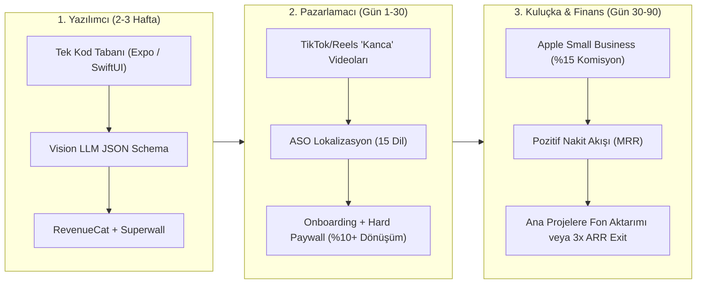

# App Store Gelir & İndirme Analizi: Hızlı Nakit Akışı (Runway) Üretecek Proje Raporu

> [!IMPORTANT]
> **Stratejik Hedef:** Bu raporun amacı "geleceğin unicorn'unu" bulmak değil; **en düşük geliştirme maliyeti ve en kısa sürede (30–60 gün içinde) pozitif nakit akışı üreterek** asıl büyük projelerinize sermaye (runway) sağlayacak **"Nakit İneği" (Cash-Cow)** mobil uygulamayı tasarlamaktır.

---

## 1. App Store Pazar Araştırması: İndirme Sayısı Yüksek vs. Hızlı Para Kazandıran Kategoriler

RevenueCat’in **115.000+ uygulama ve \$16 Milyar+** gelir verisini incelediği *State of Subscription Apps (SOSA)* raporları ile güncel App Store trendleri incelendiğinde, **ham indirme sayısı** ile **solo/küçük ekip kârlılığı** arasında kritik bir ayrım ortaya çıkmaktadır:

### A. App Store'da Şu An En Çok İndirilen ve Gelir Üreten 4 Ana Dalga

| Kategori / Model | Örnek Başarılı Uygulamalar | Aylık İndirme / Gelir Ölçeği | Solo / Küçük Ekip İçin Uygunluk |
| :--- | :--- | :--- | :--- |
| **1. "Snap & Solve" (Çek ve Çöz) Görsel AI Araçları** | *Cal AI* (Kalori), *PictureThis* (Bitki), *CoinSnap* (Madeni Para), *Rock Identifier* | 500B – 3M+ İndirme / Ay   **\$500B – \$3.5M+ MRR** | **Çok Yüksek (En Hızlı Nakit)**   5 saniyelik TikTok/Reels videolarıyla sıfır reklam bütçesiyle viral olabiliyor. |
| **2. Ses / Doküman -> Yapılandırılmış Çıktı (AI Üretkenlik)** | *Coconote* (Ders Notu), *AudioPen*, *Wave AI*, PDF Tarayıcı & Özetleyiciler | 100B – 800B İndirme / Ay   **\$100B – \$600B+ MRR** | **Yüksek**   Öğrenciler ve beyaz yakalılar arasında yüksek ödeme eğilimi (Willingness to Pay). |
| **3. Niş Saha & Mikro-Üretkenlik Araçları (Micro-SaaS)** | *Momego* (Ulaşım), *HabitKit* (Alışkanlık), Fatura/Fiş Takipçileri | 50B – 500B İndirme / Ay   **\$15B – \$45B+ MRR** | **Çok Yüksek (En Düşük Churn)**   ASO (App Store Arama Optimizasyonu) ile reklamsız pasif gelir üretir. |
| **4. Genel AI Sohbet & Oyunlar** | *ChatGPT*, *Nova*, *Monopoly GO!* | 5M – 50M+ İndirme / Ay | **Çok Düşük (Kaçınılmalı)**   Müşteri edinme maliyeti (CAC) aşırı yüksek, büyük teknoloji devleriyle doğrudan rekabet var. |

### B. Kritik Veri İçgörüleri (Benchmarklar)
1. **Dönüşüm Hızı (Day-0 Etkisi):** Uygulama içi abonelik denemelerinin (Trial) **%80 ila %90'ı uygulamanın indirildiği ilk gün (Day 0)**, hatta ilk 3 dakika içinde başlar.
2. **Hard Paywall vs. Freemium:** Uygulama açılışında değer önerisini gösterip doğrudan ödeme ekranı çıkaran (**Hard Paywall**) uygulamaların medyan dönüşüm oranı **%10.7** iken, klasik Freemium uygulamalarda bu oran sadece **%2.1**'dir (5 kat fark).
3. **Gelir Çarpanı:** AI destekli yardımcı araçlar (Utilities), kullanıcı başına yıllık medyan **\$30.16** gelir üretirken standart uygulamalarda bu rakam **\$21.37** seviyesindedir (%41 daha yüksek gelir).

---

## 2. Projelerinize Finansman Sağlayacak En Hızlı Gelir Modeli Önerisi

Ana projelerinize zaman ve para kaybetmeden fon sağlamak için **"AI-Powered Snap & Audit" (Fotoğrafını Çek -> Anında Analiz/Değerleme/Çözüm Al)** mimarisine sahip bir mikro-uygulama (veya aynı kod tabanından türetilmiş 2-3 niş uygulama) en doğru stratejidir.

### Önerilen 3 Somut "Hızlı Nakit" (Cash-Cow) Konsepti

Aynı teknik altyapıyı (Kamera -> Vision API / OCR -> Yapılandırılmış JSON -> Şık Rapor Kartı) kullanarak 2-3 haftada yayına çıkabileceğiniz 3 yüksek dönüşümlü seçenek:

#### Seçenek A (En Yüksek Viral & B2C Potansiyeli): **Kozmetik / Gıda İçerik & Alerjen Tarayıcı ("Temiz İçerik / Cilt Uyumu AI")**
* **Problem:** Kullanıcılar markette veya kozmetik alışverişinde ürün arkasındaki karmaşık kimyasal içerikleri (INCI listesi, E-kodları) anlayamıyor. *Yuka* gibi barkod okuyan uygulamalar yeni/yerel ürünlerde barkod veritabanında bulunamadığı için hata veriyor.
* **Çözüm:** Barkod aramak yerine doğrudan **içindekiler kısmının fotoğrafını çekiyorsunuz**. Uygulama 3 saniyede kullanıcının profiline göre (örn: *Akneye meyilli cilt, hamilelik dönemi, İnsülin direnci, Gluten hassasiyeti*) kırmızı/yeşil bayraklı güvenlik skoru (0-100) ve temiz alternatif önerisi çıkarıyor.
* **Neden Hemen Para Kazandırır?** Sağlık, bebek bakımı ve cilt bakımı kaygısı (pain point) en yüksek dürtüsel satın alma (impulse buy) kategorisidir. Market koridorunda ürünü eline alan kullanıcı o an sonucu görmek için haftalık/yıllık aboneliği anında başlatır.

#### Seçenek B (En Yüksek ARPU / B2B2C Potansiyeli): **Serbest Çalışan & Küçük Esnaf İçin "Çek-Fişi / Sözleşmeyi" Finans & Risk Asistanı**
* **Problem:** Küçük işletmeler, saha çalışanları ve freelancer'lar kağıt fişleri, faturaları veya imzalayacakları kira/hizmet sözleşmelerini incelemeye vakit bulamıyor.
* **Çözüm:** Fişin fotoğrafını çekince otomatik KDV/kategori ayrıştırması yapıp Excel/PDF raporu üreten veya bir sözleşme sayfasının fotoğrafını çekince *"Seni riske sokan 3 gizli madde"* uyarısı veren cep asistanı.
* **Neden Hemen Para Kazandırır?** Kullanıcı kitlesi "iş" için kullandığından **\$9.99/hafta** veya **\$49.99/yıl** ödemekten çekinmez.

#### Seçenek C (Koleksiyoner & İkinci El Arbitraj): **"Snap & Value" İkinci El / Antika / Saat / Kart Değerleme**
* **Problem:** Bit pazarları, ikinci el kıyafet (thrift store) veya koleksiyon meraklıları gördükleri bir objenin (vintage ürün, saat, figür, nadir kitap) gerçek piyasa değerini ve orijinalliğini o saniyede öğrenmek istiyor.
* **Çözüm:** Fotoğrafı çekilen ürünün görsel eşleşmesini ve eBay/ikinci el pazarlarındaki ortalama satış fiyat aralığını çıkaran araç.
* **Neden Hemen Para Kazandırır?** Kullanıcı *"Bu ürünü \$10'a alıp \$150'a satabilir miyim?"* motivasyonuyla (para kazanma arzusuyla) uygulamaya hemen abone olur.

---

## 3. Üç Farklı Perspektiften 360° Detaylı Analiz

Aşağıda, seçeceğiniz **"Snap & Solve"** modelinin en kısa sürede nakit üretmesi için **Yazılımcı**, **Pazarlamacı** ve **Kuluçka Geliştirici** gözünden uygulanması gereken strateji yer almaktadır.

---

### Perspektif 1: Yazılımcı (Software Engineer / System Architect) Analizi

Bir yazılımcı olarak en büyük tuzak **"Over-engineering" (Aşırı Mühendislik)** yapmaktır. Amacınız kusursuz bir mikroservis mimarisi kurmak değil, **14–21 gün içinde** ödeme alabilen bir ürünü mağazaya sokmaktır.

#### 1. Teknoloji Yığını (Hız Odaklı Stack)
* **Frontend:** **React Native (Expo)** veya doğrudan yalnızca iOS hedefleniyorsa **SwiftUI**.
  * *Tavsiye:* Eğer ikinci ve üçüncü niş uygulamaları (klon/fabrika modeliyle) hızlıca çıkarmak istiyorsanız **Expo + TypeScript** ile modüler bir "Boilerplate" kurun. Kamera, Onboarding, Paywall ve Auth katmanlarını bir kez yazıp her yeni uygulama fikrinde %80 kodu yeniden kullanın.
* **Backend & Veritabanı:** **Supabase** (PostgreSQL + Edge Functions). Sıfır sunucu yönetimi. Hatta kullanıcı geçmişini cihaz içinde (**SQLite / SwiftData**) tutarak veritabanı maliyetini **\$0** seviyesine çekebilirsiniz (Local-First mimari).
* **AI & Maliyet Optimizasyonu (Kritik Mühendislik Detayı):**
  * **Hibrit OCR Yaklaşımı:** Kullanıcının çektiği fotoğrafı doğrudan pahalı bir Vision modeline göndermek yerine, önce iOS'un yerleşik ve **tamamen ücretsiz** olan `VNRecognizeTextRequest` (Apple Vision Framework) API'si ile cihaz üzerinde (on-device) metni çıkarın.
  * Çıkan ham metni **Gemini 2.5 Flash** veya **GPT-4o-mini** modeline Structured Outputs (JSON Schema) ile gönderin.
  * **Maliyet Etkisi:** Doğrudan görsel göndermek yerine cihazda OCR + hafif LLM kullanmak, 1.000 tarama maliyetini **\$3.00'dan \$0.08'e (8 cent)** düşürür. Brüt kâr marjınız **%98+** olur.
* **Ödeme & Paywall Altyapısı:**
  * **RevenueCat:** StoreKit 2 entegrasyonunu ve abonelik durumlarını 2 saatte çözmek için.
  * **Superwall:** Uygulamaya yeni güncelleme göndermeden (App Store onayını beklemeden) uzaktan farklı fiyatlandırma ve ödeme ekranlarını (A/B testi) değiştirebilmek için şarttır.

#### 2. 14 Günlük MVP Geliştirme Takvimi
* **Gün 1–3:** Boilerplate kurulumu, Kamera/OCR modülü ve Edge Function üzerinden LLM JSON yanıtının alınması.
* **Gün 4–6:** Sonuç ekranı UI tasarımı (Skor halkası, Kırmızı/Sarı/Yeşil maddeler, Paylaşılabilir özet kartı).
* **Gün 7–10:** 6-8 adımlı "Kişiselleştirme Onboarding" akışı + Superwall/RevenueCat entegrasyonu.
* **Gün 11–14:** App Store ekran görüntüleri, gizlilik politikası, TestFlight ve App Store Review gönderimi.

> [!WARNING]
> **App Store Guideline 4.2 (Minimum Functionality) ve 3.1.1 Uyarıları:**
> Apple, basit "ChatGPT sarmalayıcılarını" (wrapper) reddediyor. Uygulamanızda sohbet kutusu (chat interface) **kesinlikle olmamalıdır**. Kamera arayüzü, özel grafiksel skor kartları, geçmiş taramalar listesi ve yerel bildirimler ile "özel amaçlı bir araç (utility)" görünümü vermelisiniz. Ayrıca ilk açılışta kayıt (Sign-up) zorunluluğu koymayın; anonim ID ile başlatıp ödeme sonrasında Apple ile Giriş Yap (Sign in with Apple) sunun.

---

### Perspektif 2: Pazarlamacı (Growth Marketer & ASO Uzmanı) Analizi

App Store'da en iyi kodlanmış uygulama değil, **dağıtım kanalı (distribution) ve dönüşüm hunisi (funnel) en iyi kurgulanmış** uygulama para kazanır.

#### 1. Product-Channel Fit: 5 Saniyelik "Kanca" (Hook) Tasarımı
Uygulamanın ana ekranını tasarlarken kendinize şu soruyu sormalısınız: *"Bu ekran, TikTok/Reels videosunda 3. saniyede izleyiciyi şok edebilir mi?"*
* **Organik Kısa Video Stratejisi (Sıfır Bütçe):**
  * **Kanca (0–2. sn):** Marketten çok popüler ve "sağlıklı/doğal" sanılan bir ürünü elinize alın: *"Bebeğinize / cildinize her gün sürdüğünüz bu şampuanın içinde ne var biliyor musunuz?"*
  * **Aksiyon (2–4. sn):** Uygulamayı açıp ürünün arkasını taratın (ekranda şık bir tarama animasyonu döner).
  * **Sonuç (4–7. sn):** Ekranda kırmızı bir **18/100 Tehlike Skoru** ve parlayan kırmızı uyarı maddesi belirir.
  * **Sonuç:** Yorumlarda yüzlerce kişi *"Uygulamanın adı ne?"* diye sorar. Bu organik döngü (Cal AI ve Yuka'nın büyüme motoru) reklama tek kuruş harcamadan binlerce indirme getirir.

#### 2. ASO (App Store Optimization) ve Lokalizasyon Arbitrajı
* ABD pazarında rekabet yüksektir ancak **Almanya, Fransa, İspanya, Brezilya, Japonya, Güney Kore ve Orta Doğu (Suudi Arabistan/BAE)** pazarlarında yerel dilde optimize edilmiş niş araç sayısı çok azdır.
* Uygulama başlığını (30 karakter) ve alt başlığını (30 karakter) 15 farklı dile lokalize edin. Sadece bu hamle, küresel uzun kuyruk (long-tail) aramalardan günde 100–300 tamamen ücretsiz organik indirme getirir.

#### 3. Yüksek Dönüşümlü Onboarding & Paywall Psikolojisi
Kullanıcı uygulamayı indirdiğinde doğrudan kamerayı açmayın! RevenueCat verilerine göre dönüşümü %2'den %10+'ya çıkaran akış şöyledir:
1. **Mikro-Taahhüt (5-6 Soruluk Test):** *"Cilt tipiniz nedir?"*, *"Hangi bileşenlerden kaçınıyorsunuz?"*, *"Ayda kişisel bakıma ne kadar harcıyorsunuz?"* (Kullanıcı kendi verisini girdikçe uygulamaya duygusal yatırım yapar — *Sunk Cost Fallacy*).
2. **Yükleme Ekranı ("Profiliniz Özelleştiriliyor..."):** 3 saniyelik güven veren bir analiz animasyonu (sosyal kanıt yorumlarıyla birlikte).
3. **Hard Paywall / Reverse Trial:** Kullanıcının karşısına **3 Gün Ücretsiz Deneme + Yıllık Plan (\$29.99 - \$39.99/yıl)** ve yanında **Haftalık Plan (\$4.99 - \$6.99/hafta)** çıkarın.
4. **Terk Etme Yakalayıcı (Exit-Intent Offer):** Kullanıcı ödeme ekranındaki `X` (Kapat) butonuna basarsa, anında tek seferlik **"%50 İndirimli Yıllık Plan"** veya **"1 Ücretsiz Tarama Hakkı"** sunun. İlk taramayı yaptığında sonucun ilk 2 maddesini gösterip, detaylı analiz için tekrar Paywall çıkarın (*Blurred Result Paywall*).

---

### Perspektif 3: Kuluçka Geliştirici (Incubator / Venture Builder) Analizi

Bir kuluçka merkezi veya melek yatırımcı gözüyle baktığımızda, bu projenin tek bir varlık sebebi vardır: **Sermaye Verimliliği (Capital Efficiency)** ve **Ana Projelere Finansman (Cross-Subsidization)**.

#### 1. Birim Ekonomisi (Unit Economics) ve Gelir Simülasyonu
Apple'ın **App Store Small Business Program**'ına başvurduğunuzda (yıllık geliriniz \$1M altında olduğu için) Apple komisyonu %30'dan **%15'e** düşer.

Mühendislik ve pazarlama adımlarını doğru uygulayan mütevazı bir baz senaryo (3. Ay projeksiyonu):

$$
\text{Aylık Organik + Viral İndirme} = 10.000 \text{ İndirme}
$$

* **Deneme Başlatma Oranı (Trial Start Rate):** %8 (800 kullanıcı)
* **Denemeden Ödemeye Dönüşüm (Trial-to-Paid):** %40 (320 net yeni abone)
* **Paket Dağılımı:**
  * %60 Yıllık Plan (\$34.99/yıl) $\rightarrow 192 \times \$34.99 = \$6,718$ (Anında peşin nakit girişi!)
  * %40 Haftalık/Aylık Plan (Ort. \$12/ay) $\rightarrow 128 \times \$12 = \$1,536$
* **Toplam Brüt Aylık Nakit Girişi:** **~\$8,254 / Ay**
* **Kesintiler ve Giderler:**
  * Apple Komisyonu (%15): $-\$1,238$
  * AI / Sunucu Maliyeti (Cihaz içi OCR + Flash LLM): $-\$45$
  * Sabit Araçlar (Apple Dev + Superwall/RevenueCat): $-\$100$
* **Net Kâr (Ana Projelerinize Aktarılacak Fon):** **~\$6,870 / Ay**

#### 2. Nakit Akışı (Cashflow) Takvimi ve "Apple Ödeme Vadesi" Uyarısı
> [!CAUTION]
> **Kuluçka Yöneticisi Uyarısı (Tahsilat Süresi):**
> App Store'da bugün kazandığınız parayı yarın banka hesabınıza çekemezsiniz. Apple, içinde bulunduğunuz mali ayın gelirlerini ay kapandıktan yaklaşık **30 ila 45 gün sonra** hesabınıza yatırır.
> * **Örnek:** 1 Kasım'da yayına çıkıp Kasım boyunca \$5,000 satış yaparsanız, bu para banka hesabınıza **Ocak ayının başında** yatar.
> * **Çözüm (Hızlı Nakit İçin Hibrit Model):** Eğer paraya 45 gün sonra değil **bu hafta** ihtiyacınız varsa, uygulamanın yanına basit bir **Web-to-App hunisi (Stripe / LemonSqueezy)** kurun veya reklam trafiğini önce mobil web'deki 5 soruluk teste yönlendirip ödemeyi Stripe ile web'de alın (7 günde nakit hesaba geçer), ardından kullanıcıyı giriş yapması için App Store uygulamasına yönlendirin.

#### 3. "Portfolio / Fabrika" Yaklaşımı ve Exit (Satış) Opsiyonu
Kuluçka perspektifinden en büyük avantaj şudur:
1. **Aşama 1 (Ay 1):** Tek bir çekirdek mimari ("Snap -> OCR/Vision -> JSON -> Skor Kartı") yazılır.
2. **Aşama 2 (Ay 2):** İlk uygulama (örn. Kozmetik/Gıda İçerik Tarayıcı) yayına alınır ve aylık \$3K–\$5K nakit üretmeye başlar.
3. **Aşama 3 (Ay 3):** Aynı kod tabanının sadece sistem komutunu (System Prompt), renk paletini ve ikonunu değiştirerek **3 gün içinde** ikinci niş uygulamayı (örn. *Evcil Hayvan Mama & Bitki Toksisite Tarayıcı* veya *Fatura/Sözleşme Risk Tarayıcı*) yayına alırsınız.
4. **Aşama 4 (Sermaye Çıkışı - Micro-Exit):** Ana projeniz için toplu bir sermayeye (örn. \$50.000 - \$100.000 nakit) ihtiyacınız olduğunda, aylık \$3,000 net kâr bırakan bir iOS uygulamasını **Acquire.com** veya **Flippa** üzerinde yıllık kârının **2.5x ila 3.5x çarpanıyla (\$90,000 - \$120,000 peşin bedelle)** 30-45 gün içinde satabilirsiniz.

---

## 4. Özet Karar Matrisi: Hangi Projeden Başlamalıyız?

| Kriter | 1. Kozmetik & Gıda İçerik Tarayıcı | 2. Fiş & Sözleşme Risk Analizörü | 3. İkinci El / Koleksiyon Değerleme |
| :--- | :---: | :---: | :---: |
| **Geliştirme Süresi (MVP)** | 10–14 Gün | 14–20 Gün | 14–21 Gün |
| **TikTok/Reels Viral Potansiyeli** | ⭐⭐⭐⭐⭐ (Çok Yüksek) | ⭐⭐⭐ (Orta) | ⭐⭐⭐⭐⭐ (Çok Yüksek) |
| **ASO (Arama) Hacmi** | ⭐⭐⭐⭐ | ⭐⭐⭐⭐⭐ | ⭐⭐⭐⭐ |
| **Yıllık Peşin Abonelik Oranı** | ⭐⭐⭐⭐⭐ | ⭐⭐⭐⭐ | ⭐⭐⭐ (Genelde haftalık alınır) |
| **Yapay Zeka API Maliyeti** | Çok Düşük (Cihaz içi OCR yeterli) | Çok Düşük (Cihaz içi OCR yeterli) | Orta (Görsel Vision API gerekir) |

> [!TIP]
> **Kuluçka & Mühendislik Ortak Tavsiyesi:**
> En düşük API maliyeti (cihaz içi ücretsiz OCR + metin tabanlı LLM) ve en yüksek TikTok/Reels viral kancasına sahip olduğu için **1. Seçenek (Kozmetik & Gıda İçerik / Alerjen Tarayıcı)** veya doğrudan para/iş odaklı **2. Seçenek (Sözleşme & Fatura Risk/Gider Tarayıcı)** ile başlamak en kısa sürede en yüksek net kârı bırakacaktır.
