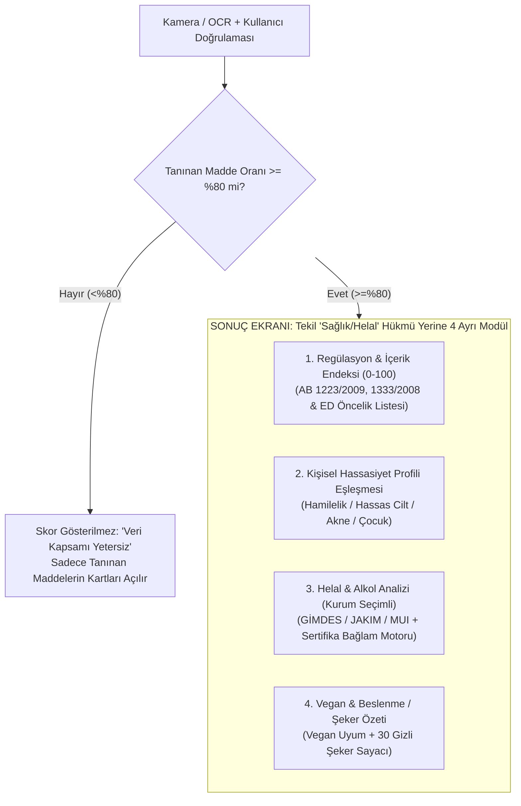

# Nihai Çapraz Doğrulama Raporu: Bilimsel Konsensüs ve Kural Motoru Mimarisi

> [!IMPORTANT]
> **Yönetici Özeti:**
> Yaptığınız çapraz doğrulama hamlesi uygulamayı **hem olası marka davalarından (TTK haksız rekabet / kötüleme) hem de App Store 1.4.1 retlerinden** kurtarmıştır. İki bağımsız yapay zeka denetimi (AI-1 ve AI-2), ilk taslaktaki aşırı genellemeleri temizleyerek **endüstri standardında, kanıta dayalı bir veri mimarisi** ortaya çıkarmıştır.

---

## 1. İki Yapay Zekanın %100 Uzlaştığı 12 Kritik Düzeltme (Kesinleşen Kurallar)

Kodlamaya geçerken veritabanımıza (`maddeler.json` ve `helal.csv`) doğrudan işlenecek, tartışmaya kapalı düzeltmeler şunlardır:

| # | Konu | Eski (Hatalı/Riskli) Yaklaşım | Yeni (Doğrulanmış & Hukuken Güvenli) Kural |
| :--- | :--- | :--- | :--- |
| **1** | **Parabenler** | "Tüm parabenler yüksek/orta riskli hormon bozucudur." | **3'e Ayrıldı:**  🔴 *Yasaklı (Ek II - 358/2014):* Isopropyl-, Isobutyl-, Phenyl-, Benzyl-, Pentylparaben. 🟡 *Kısıtlı / ED Grup A (Ek V - 1004/2014):* Propyl- ve Butylparaben (toplam %0.14 sınır; <3 yaş bez bölgesinde yasak). 🟢 *İzinli / Grup B:* Methylparaben (E218) ve Ethylparaben (E214) (%0.4 sınırla güvenli; kırmızı alarm verilmez). |
| **2** | **E441 ve Jelatin** | "E441 = Domuz Jelatini (Kesin Haram)." | **Düzeltildi:** Güncel AB 1333/2008'de jelatin katkı değil bileşendir, **E441 resmi kod değildir**. Etikette sadece *"Gelatin/Jelatin"* yazıyorsa kaynak (sığır/balık/domuz) belirsizdir $\rightarrow$ **Kategori C (Müşbooh)**. Yalnızca *"Pork/Porcine Gelatin"* yazarsa **Kategori A (Haram)** olur. |
| **3** | **Karmin (E120) & E124 Tuzağı** | "Karmin böcek kanıdır ve her yerde kesin haramdır." | **Düzeltildi:** Karmin (*E120 = Carmine = Cochineal = CI 75470*) böcek kanı değil, karminik asittir. GİMDES haram sayarken **MUI (33/2011) ve JAKIM/MKI (2012)** helal sayar $\rightarrow$ **Kategori D (Kurum Farkı)**.  ⚠️ **Kritik Tuzak:** *E124 (Ponceau 4R)* diğer adı *"Cochineal Red A"*'dır ama sentetiktir, böcekle ilgisi yoktur! |
| **4** | **Lesitin (E322)** | "Lesitin helal açısından şüphelidir." | **Düzeltildi:** Ticari lesitin soya, ayçiçeği veya yumurtadan üretilir. Yumurta helal olduğu için Lesitin **Helal (Kategori H)** sınıfındadır; yalnızca **Vegan** filtresinde (yumurta ihtimaliyle) sarı uyarı verir. |
| **5** | **Alkol ve `Phenoxyethanol` Tuzağı** | İçinde `alcohol` veya `ethanol` geçenleri yakalamak. | **Alt-dizi (Substring) Araması Yasaklandı:** `Phenoxyethanol` içinde *"ethanol"* geçer ama koruyucudur, etil alkol değildir. `Benzyl Alcohol` aromatik alkoldür. `Cetyl/Stearyl/Cetearyl Alcohol` yağ alkolüdür. `Sorbitol/Xylitol` şeker alkolüdür. `Isopropyl Alcohol` içki alkolü (etanol) değildir. |
| **6** | **Kozmetikte Etanol** | `Alcohol Denat.` görünce "Haram Ürün" demek. | **Düzeltildi:** Harici (cilt) kullanımında sentetik/endüstriyel etanol hakkında fetva kurumları arasında görüş ayrılığı vardır. Uygulama *"Haram"* demez; **"Etil alkol (etanol) içerir"** der ve kullanıcının seçtiği hassasiyet profiline göre renklendirir. |
| **7** | **E171 / CI 77891 (Titanyum Dioksit)** | Tekil değerlendirme. | **Ürün Tipi (`gida` vs `kozmetik`) Ayrımı Şart:** Gıdada (*E171*) AB 2022/63 ile **YASAKLANDI (Kırmızı)**. Ancak kozmetikte (*CI 77891*) renklendirici/UV filtresi olarak **İZİNLİDİR**. |
| **8** | **Sülfitler (E220–E228) & BHT (E321)** | "Kanserojen koruyucular" grubunda saymak. | **Düzeltildi:** Sülfitler kanserojen değildir; **Astım / Alerji** riskidir (>10 mg/kg beyan zorunlu). **BHT (E321)** IARC Grup 3'tür (kanserojen sınıflaması yok), **BHA (E320)** ise IARC Grup 2B'dir. İkisi aynı kefeye konmaz. |
| **9** | **BHA Çift Anlamlılığı** | "BHA" görünce tek maddeye eşlemek. | **Düzeltildi:** Kozmetikte `"BHA"`, antioksidan olan *Butylated Hydroxyanisole* de olabilir, soyucu asit olan *Salicylic Acid (Beta Hydroxy Acid)* de olabilir. Tek başına `"BHA"` okunursa kullanıcıdan doğrulama istenir. |
| **10** | **Hamilelik: Retinoid vs. Bakuchiol** | Bakuchiol ve tüm uçucu yağları "Teratojenik Kırmızı" yapmak. | **Düzeltildi:** İlaç retinoidleri (*Tretinoin, Isotretinoin*) AB kozmetikte zaten yasaktır. Kozmetik *Retinol / Retinyl Palmitate* (AB 2024/996 sınırları) **ihtiyat ilkesiyle** Hamilelik profilinde Kırmızı gösterilir. **Bakuchiol** retinoid değildir $\rightarrow$ `veri_yok` olarak etiketlenir. Formaldehit salıcılar hamilelikten **Hassas Cilt (Alerji)** profiline taşındı. |
| **11** | **Komedojenik Ölçek (0–5)** | CIR kaynaklı genel puan düşürücü. | **Düzeltildi:** Kaynak CIR değil, *Fulton (1989)* tavşan kulağı testleridir (*Draelos 2006* bitmiş formülün farklı davrandığını göstermiştir). Genel skoru **düşürmez**, sadece "Akneye Meyilli Cilt" profilinde bilgi/sarı rozet olarak gösterilir. Saf *Lanolin* düşük komedojeniktir (*Acetylated Lanolin Alcohol* yüksektir). |
| **12** | **SLS vs. SLES** | İkisini de aynı sertlikte göstermek. | **Düzeltildi:** *SLS (Sodium Lauryl Sulfate)* bilinen tahriş edicidir (`sari`), *SLES (Sodium Laureth Sulfate)* daha yumuşaktır (`bilgi`). |

---

## 2. İki Yapay Zekanın Ayrıştığı Tek Nokta ve "Hibrit" Çözümümüz: Puanlama Mimarisi

İki denetim raporu arasında tek bir tasarım farkı vardır:
* **AI-1 (Akademik/Hukuki Yaklaşım):** *"0–100 arası evrensel bir sağlık puanı bilimsel değildir, `null` olmalıdır. Sadece modüler kartlar ve kullanıcının seçtiği kriterlere göre Tercih Eşleşme Oranı gösterilmelidir."*
* **AI-2 (Ürün/Tasarım Yaklaşımı):** *"0–100 arası bir endeks verilebilir (yasaklı madde varsa tavan 10, yüksek risk varsa 40, 3+ orta risk varsa 60); ancak bunun resmi bir kurum puanı değil uygulamanın kendi metodolojisi olduğu açıkça yazılmalı, tanınan madde oranı <%80 ise skor gizlenmeli ve Helal/Hamilelik/Akne uyarıları bu skora karıştırılmamalıdır."*

### Kuluçka & Pazarlama Sentezi: **"4 Bağımsız Kart + Şeffaf Metodoloji Endeksi"**

TikTok/Reels videolarında ve market koridorunda kullanıcının 3 saniyede ekranı anlaması için görsel bir özet şarttır; ancak hukuki güvenlik için de AI-1'in kurallarına uymalıyız. İkisini birleştiren **Nihai Sonuç Ekranı Mimarisi**:

1. **Helal, Hamilelik ve Akne uyarıları ASLA 0–100 puanını değiştirmez.** (Örn: İçinde domuz jelatini olan ama kimyasal olarak "temiz" bir ürünün Regülasyon Endeksi yüksek olabilirken, **Helal Kartı KIRMIZI** yanar. Böylece bilimsel kavramlar birbirine karışmaz).
2. **Ülke/Pazar Ayrımı:** AB'de yasaklı bir madde (örn. *Lilial* veya gıdada *E171*) bulunduğunda *"Yasa dışı ürün"* denmez; **"AB Kozmetik/Gıda Yönetmeliği kapsamında AB'de kullanılamaz (Tavan Endeks: 10/100)"** rozeti gösterilir.

---

## 3. Helal, Alkol ve Vegan "Bağlam Motoru" (Context Engine)

AI-2'nin oluşturduğu 5'li Helal sınıfı (`A_haram`, `B_alkol`, `C_musbooh`, `D_tartismali`, `H_helal`) ile AI-1'in kanıt düzeyi (`declared` / `logo_detected` / `verified`) birleştirilmiştir:

1. **Sertifika / Logo Çelişki Yakalayıcı (`CONFLICT`):**
   * Ürün üzerinde **"Vegan"** logosu/yazısı var AMA içindekilerde *Kolajen, Keratin, Jelatin, Karmin (E120), Şellak (E904), Lanolin, Balmumu (E901), Peynir Altı Suyu (Whey)* okunduysa $\rightarrow$ Otomatik yeşil verilmez! **"ÇELİŞKİ UYARISI: Etiketteki hayvansal bileşen ile Vegan ibaresi çelişiyor, OCR okumasını veya üretici beyanını kontrol edin"** uyarısı çıkar.
2. **Vegan İbaresi Neyi Çözer, Neyi Çözmez?**
   * Ürün **Vegan** ise: Bitkisel/hayvansal çift kaynaklı yağ asitleri ve emülgatörler (**E471–E477, E470, E570 Stearik Asit, E422 Gliserin, Magnezyum Stearat, Squalene**) hayvansal olamayacağı için `C_musbooh` durumundan çıkarılıp **Bitkisel / Uygun** sınıfına yükseltilir.
   * **İstisna 1:** Vegan logosu **Etil Alkolü (`B_alkol`) ÇÖZMEZ!** (Üzüm/tahıl alkolü vegandır ama helal açısından tartışmalıdır).
   * **İstisna 2:** Vegan logosu **L-Sistein'i (E920)** tam çözmez (insan saçı kaynaklı üretim hayvan içermediği için teknik olarak vegan sayılabilir ama İslami açıdan haramdır $\rightarrow$ Sarı kalır).
3. **Vejetaryen İbaresi Tuzağı:**
   * *"Vegetarian"* logosu E471 veya Gliserin kaynağını çözer ancak **Peynir Altı Suyu (Whey) / Peynir Mayası (Rennet)** sorununu çözmez.

---

## 4. OCR Normalizasyon ve "Yanlış Eşleşme" Koruma Kuralları

Kamera okumasında yanlış madde eşleşmesini (halüsinasyonu) sıfırlamak için uygulanacak katı kurallar:

1. **E-Kodu ve CI Kodunda Sıfır Bulanıklık (Exact Code Match):**
   * `E120` (Karmin) ile `E129` (Allura Red) veya `E250` (Nitrit) ile `E252` (Nitrat) arasında sadece 1 rakam fark vardır! Bu yüzden **kodlarda Levenshtein (bulanık eşleştirme) KESİNLİKLE KAPALIDIR.**
   * Sadece OCR karakter dönüşümü (`C1 7547O` $\rightarrow$ `CI 75470`) aday olarak üretilir ve ekranın üstünde fotoğraf kırpıntısıyla birlikte kullanıcıya **"Okunan kod CI 75470 mi?"** diye tek dokunuşlu onay sorulur.
2. **Kimyasal Önek Koruması (Prefix Lock):**
   * `Methyl-`, `Ethyl-`, `Propyl-`, `Butyl-`, `Iso-`, `Lauryl-`, `Laureth-`, `Lauroyl-` ve `Squalene` vs `Squalane` kelimeleri birbirine **asla** otomatik dönüştürülmez.
3. **Veritabanı Doğrulama Etiketi (`dogrulama` Filtresi):**
   * Veritabanındaki her satırda `ikincil_kontrol` | `model_bilgisi` | `dogrulanmadi` etiketi bulunur. Kural motoru çalışma zamanında `dogrulanmadi` etiketli hiçbir kuralı **puan kırmak veya kırmızı alarm vermek için kullanmaz**.

---

## 5. KVKK / GDPR ve App Store Gizlilik Mimarisi (Çok Kritik!)

AI-2'nin tespit ettiği çok önemli bir hukuki detay:
* Kullanıcının seçtiği *"Hamileyim"*, *"Egzamam var"*, *"İnsülin direncim var"* veya *"Dini/Helal hassasiyetim var"* bilgileri **KVKK Madde 6 ve GDPR Madde 9 kapsamında "Özel Nitelikli Kişisel Veri"dir (Sağlık ve İnanç Verisi)!**
* **Mühendislik Çözümümüz (Zero-Server-PII):**
  * Kullanıcının seçtiği bu sağlık ve helal profillerini **sunucuya (Supabase'e) HİÇ GÖNDERMEYECEĞİZ!**
  * Bu tercihler %100 kullanıcının kendi telefonunun hafızasında (`AsyncStorage` / `SecureStore` / `SQLite`) tutulacak ve kural eşleştirmesi telefonun içinde çalışacaktır.
  * **Sonuç:** Sunucuda hiçbir sağlık/inanç verisi tutulmadığı için KVKK/GDPR açık rıza yükü ve veri sızıntısı riski **tamamen ortadan kalkar!** (Ayrıca sunucu maliyeti de sıfırlanır).

---

## 6. Şimdi Kodlamaya Hazırız: Uygulama İskeleti Planı

Elbette! İkinci yapay zekanın ürettiği JSON/CSV kurallarını (`maddeler.json`, `helal.csv`, `yanlis-pozitif.csv`) ve birinci yapay zekanın kanıt/durum mimarisini birleştirerek projeyi başlatabiliriz.

Yeni projemizi `C:\Users\fakma\.gemini\antigravity\scratch\clean-halal-scanner` dizininde oluşturup aşağıdaki modülleri kurmaya başlayalım mı?
1. **Veri & Kural Motoru (`src/engine/`):** Yukarıdaki doğrulanmış `maddeler.json` + `helal.csv` + Yanlış Pozitif Korumalı OCR Normalizatörü + 4 Kartlı Değerlendirme Motoru.
2. **Onboarding & Yerel Profil Yönetimi (`src/screens/Onboarding`):** KVKK/GDPR uyumlu, cihaz içi (Local-First) Hassasiyet & Helal Otoritesi seçimi + Paywall ekranı.
3. **Tarama ve 4 Kartlı Sonuç Ekranı (`src/screens/Scanner` & `Result`):** Kaynak atıflı (AB 1223/2009, EFSA, OIC/SMIIC), hukuki şablonlara tam uyumlu sonuç arayüzü.
